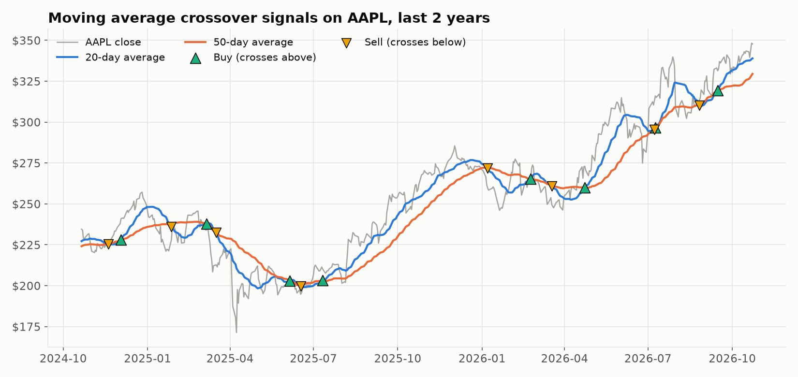
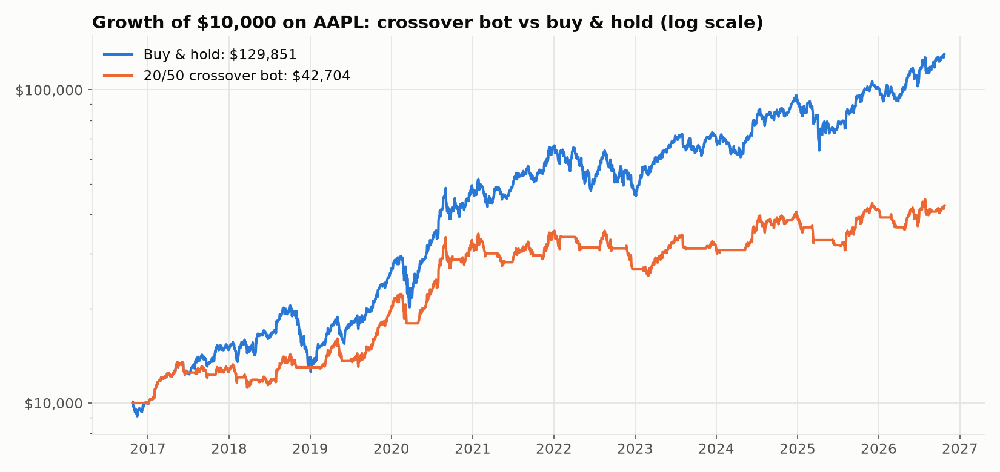
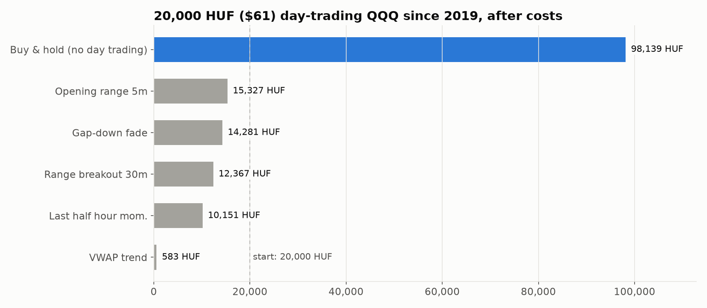

# Tradebot

An automated stock trading bot for an [Alpaca](https://alpaca.markets) **paper trading** account, plus a backtesting toolkit that tests whether its strategies are actually any good.

The bot runs every weekday after the US market close, checks the strategy you chose, and places a market order when the signal changes. The backtesters replay the same strategy code on years of daily and 5-minute history, so what you test is exactly what the bot trades.

> **The honest result:** none of the 11 strategies tested (6 daily variants, 5 day-trading) beat simply buying and holding the same stock. The point of the project was to find that out with data instead of hope. See [Results](#results).



## Features

- **Live paper trading** through the Alpaca API, with credentials kept in a `.env` file
- **Five daily strategies** in one interchangeable module: moving average crossover, monthly trend filter, 12-month momentum, RSI(2) dip buying and Donchian breakout
- **Two trading modes:** `crossover` (trade only on the day the signal flips) or `follow` (keep the account matched to the strategy, catching up after missed days)
- **Safety checks:** never sells shares it doesn't hold, never places the same order twice in one day, and has a dry-run mode
- **Daily backtester** with next-day-open fills, trading costs, buy-and-hold comparison, CAGR, max drawdown, Sharpe ratio and a full trade list
- **Strategy comparison** across symbols and periods in one command
- **Intraday backtester** for five published day-trading strategies on 5-minute bars, reporting month-by-month profit for a given budget in HUF
- **Scheduled runs** with macOS launchd, logging every run to `bot.log`
- **Unit tests** for the signal logic, strategies and simulators (offline, no API keys needed)

## How it works

```
                 ┌─────────────────┐
  yfinance  ───► │ daily prices    │
                 └────────┬────────┘
                          ▼
                 ┌─────────────────┐     same code      ┌──────────────────┐
  config.py ───► │ strategies.py   │ ◄────────────────► │ backtest.py      │
                 │ position: 1 / 0 │                    │ history + stats  │
                 └────────┬────────┘                    └──────────────────┘
                          ▼
                 ┌─────────────────┐
                 │ bot.py          │  signal changed?  ──►  Alpaca market order
                 └─────────────────┘
```

Every strategy returns a daily **position**: 1 = hold the stock, 0 = stay in cash. Positions are decided at the close; the order fills at the next open. The bot and the backtester share this code, so the backtest reproduces the bot's behavior exactly.

## Project structure

| File | Purpose |
|---|---|
| `bot.py` | Live bot: fetch prices, run the strategy, place orders on Alpaca |
| `config.py` | Symbol, trade size, strategy, settings, mode, dry run |
| `strategies.py` | The five daily strategies |
| `backtest.py` | Daily backtester and multi-strategy comparison |
| `intraday_strategies.py` | Five day-trading strategies on 5-minute bars |
| `intraday_backtest.py` | Intraday backtester with monthly profit in HUF |
| `scripts/make_charts.py` | Regenerates the charts in `docs/` |
| `deploy/com.mesziy.tradebot.plist` | macOS launchd schedule (weekdays at 22:30 Budapest time) |
| `tests/` | Offline unit tests |

## Setup

Requires Python 3.10+ and a free Alpaca account with paper trading API keys.

```bash
git clone <this repo> tradebot && cd tradebot
python3 -m venv .venv
.venv/bin/pip install -r requirements.txt
cp .env.example .env        # then paste your Alpaca paper API key and secret
```

Check the connection (read-only, places no order):

```bash
.venv/bin/python -c "import bot; a = bot.get_client().get_account(); print(a.status, a.buying_power)"
```

## Usage

**Run the bot once:**

```bash
.venv/bin/python bot.py
```

```
Run at 2026-10-25 11:22  |  strategy: ma_crossover {'short': 20, 'long': 50}
AAPL on 2026-10-23: close $347.73
  20d MA: 338.57 -> 338.91
  50d MA: 328.62 -> 329.47
  position: hold  |  mode: crossover
No signal today. No order placed.
```

**Choose a strategy** in `config.py`:

```python
SYMBOL = "AAPL"
TRADE_QTY = 1
STRATEGY = "ma_crossover"            # trend_monthly, momentum_monthly, rsi2, donchian
STRATEGY_PARAMS = {"short": 20, "long": 50}
SIGNAL_MODE = "crossover"            # or "follow"
DRY_RUN = False
```

**Backtest:**

```bash
.venv/bin/python backtest.py                                        # config.py settings, 10 years
.venv/bin/python backtest.py --strategy momentum_monthly --symbol QQQ --mode follow --years 20
.venv/bin/python backtest.py --strategy ma_crossover --param short=50 --param long=200
.venv/bin/python backtest.py --compare --years 20                   # every strategy, 5 symbols
.venv/bin/python backtest.py --compare --years 20 --cash-rate tbill # idle cash earns T-bill interest
.venv/bin/python intraday_backtest.py --budget 20000 --symbols SPY QQQ
```

The intraday backtester downloads 5-minute bars from Alpaca on first use and caches them in `data/`.

**Schedule it (macOS):** edit the paths in `deploy/com.mesziy.tradebot.plist`, then:

```bash
mkdir -p ~/Library/LaunchAgents
cp deploy/com.mesziy.tradebot.plist ~/Library/LaunchAgents/
launchctl bootstrap gui/$(id -u) ~/Library/LaunchAgents/com.mesziy.tradebot.plist
```

**Tests and charts:**

```bash
.venv/bin/pip install -r requirements-dev.txt
.venv/bin/python -m pytest
.venv/bin/python scripts/make_charts.py
```

## Results

All results use split- and dividend-adjusted prices, fills at the next day's open (or next 5-minute bar) and a trading cost per fill (0.05% daily, 0.03% intraday). Data runs to October 2026.

**Idle cash earns 0% in the tables below** unless stated, which slightly understates strategies that spend time out of the market. [Cash interest](#does-interest-on-idle-cash-change-anything) shows the effect of adding it. The Sharpe ratio is computed without subtracting a risk-free rate.

### The original bot: 20/50 crossover on AAPL, 10 years



| | 20/50 crossover | Buy & hold |
|---|---|---|
| Final value of $10,000 | $42,704 | $129,851 |
| Yearly return (CAGR) | 15.6% | 29.2% |
| Biggest drop | −28.2% | −38.5% |
| Time invested | 65% | 100% |
| Trades | 28 (50% winners) | 1 |

The bot made money but captured only about half of the stock's yearly return. Late entries and whipsaw trades in sideways markets cost more than the crashes it avoided.

### Five daily strategies, 20 years (yearly return / biggest drop)

| Strategy | SPY | QQQ | AAPL |
|---|---|---|---|
| Buy & hold | 11.0% / −55% | 16.1% / −53% | 28.3% / −61% |
| MA crossover 20/50 | 6.1% / −29% | 7.8% / −31% | 16.9% / −45% |
| MA crossover 50/200 | 8.8% / −34% | 13.4% / −29% | 20.8% / −59% |
| Trend 200-day, monthly ([Faber 2007](https://papers.ssrn.com/sol3/papers.cfm?abstract_id=962461)) | 8.6% / −27% | 12.5% / −29% | 23.5% / −65% |
| Momentum 12-month, monthly ([Moskowitz et al. 2012](https://doi.org/10.1016/j.jfineco.2011.11.003)) | 9.7% / −34% | 15.1% / −29% | 18.2% / −48% |
| RSI(2) dip buying (Connors 2008) | 2.8% / −15% | 3.1% / −14% | 5.0% / −32% |
| Donchian 55/20 breakout | 2.9% / −25% | 6.9% / −20% | 14.1% / −28% |

Slow, monthly-checked trend and momentum rules on broad funds kept most of the return while roughly halving the 2008 crash. Faster rules gave up much more. None beat buy and hold.

### Does interest on idle cash change anything?

A fair question from a reader: the strategies sit in cash roughly 10 to 90% of the time, and real cash earns interest. With `--cash-rate tbill`, idle cash earns the historical 13-week US T-bill yield (averaging 1.6% a year over these 20 years, 2.4% over the last 10).

| Yearly return, 20 years | SPY: 0% cash → T-bills | QQQ | AAPL |
|---|---|---|---|
| Buy & hold | 11.0% | 16.1% | 28.3% |
| MA crossover 20/50 | 6.1% → 6.5% | 7.8% → 8.3% | 16.9% → 17.5% |
| MA crossover 50/200 | 8.8% → 9.1% | 13.4% → 14.0% | 20.8% → 21.3% |
| Trend 200-day, monthly | 8.6% → 8.9% | 12.5% → 12.8% | 23.5% → 23.9% |
| Momentum 12-month, monthly | 9.7% → 10.0% | 15.1% → 15.4% | 18.2% → 18.4% |
| RSI(2) dip buying | 2.8% → 4.2% | 3.1% → 4.5% | 5.0% → 6.4% |
| Donchian 55/20 | 2.9% → 3.7% | 6.9% → 7.6% | 14.1% → 14.9% |

Interest adds 0.2 to 1.4 points a year, the most for strategies that are rarely invested. On the 10-year AAPL test it lifts the 20/50 bot from 15.6% to 16.7% a year, against 29.2% for buy and hold. It narrows the gap but changes no conclusion. The intraday backtester also leaves overnight cash uninvested.

### Day trading with 20,000 HUF (about $61), 2019 to 2026



18 of 20 strategy/symbol combinations lost money after costs. Most had small positive returns *before* costs, but 10 to 80 trades a month at 0.03% each turned them negative. The one standout, a 30-minute range breakout on TSLA, earned most of its profit in 2019 to 2021 and became unprofitable at slightly higher trading costs.

## What I learned

- **Test the data, not the story.** Every strategy here has a convincing rationale and published support. Most still lost to doing nothing.
- **Trading costs decide intraday strategies.** A tiny edge disappears after dozens of trades a month.
- **Check how a backtest starts.** A bot that only trades on signal flips can sit in cash for years if it starts mid-trend, which is why `follow` mode exists.
- **One good result out of 20 is probably luck.** Checking it year by year and at higher costs is what shows whether it holds up.

## Disclaimer

This is an educational project that trades on a **paper (simulated) account**. It is not financial advice. Past performance does not predict future results.

## License

[MIT](LICENSE)
